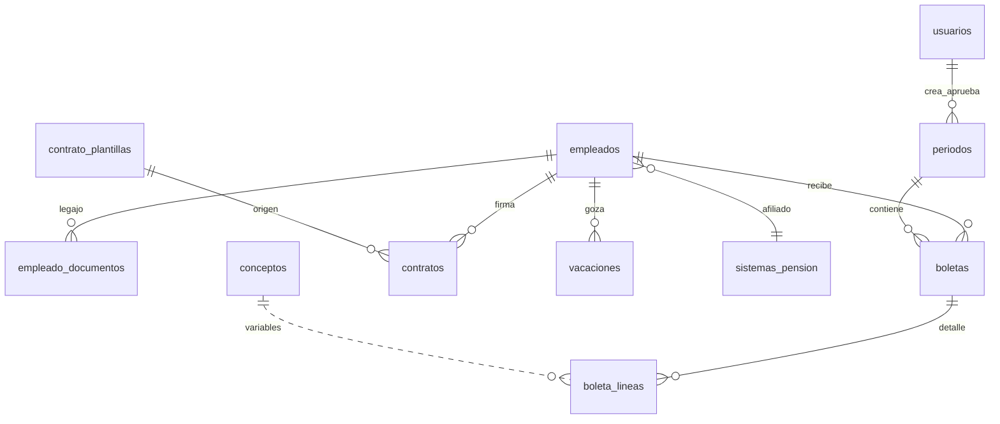

# Sistema RRHH · Planillas, boletas y contratos (Perú)

Aplicación **PHP 7.4+ / MySQL 5.7+ / JavaScript** sin dependencias externas (ni Composer ni CDN), lista para subir a **cPanel**. Diseño **BLUR** (glassmorphism).

## 1. Instalación en cPanel

1. cPanel › *Bases de datos MySQL*: cree base de datos, usuario y asígnelo con todos los privilegios.
2. Suba el contenido de esta carpeta a `public_html/` (o a un subdominio) por el Administrador de archivos / FTP.
3. Verifique en *Seleccionar versión de PHP* que estén activas las extensiones `pdo_mysql`, `zip` (lectura de .xlsx), `fileinfo`, `mbstring`, `gd`/`exif` opcionales.
4. Abra `https://su-dominio/install.php`, ingrese los datos de BD y el primer administrador (queda también como **Gerente**).
5. **Borre `install.php`** y la carpeta `tests/`.
6. Inicie sesión → *Empresa* (RUC, logo, firma de gerencia) → *Parámetros legales* (verifique RMV, UIT, tasas AFP, tope RMA, SCTR).

Las carpetas `storage/`, `includes/`, `database/` y `tests/` están bloqueadas por `.htaccess`; los archivos se sirven solo mediante `file.php` con sesión iniciada.

## 2. Módulos

| Módulo | Archivos | Descripción |
|---|---|---|
| Inicio de sesión | `login.php`, `logout.php` | Multiusuario, roles **Administrador / Usuario**, marca adicional **Gerente**. Hash `password_hash`, CSRF, bloqueo 15 min tras 5 intentos, sesión de 2 h. |
| Empresa | `empresa.php` | RUC, razón social, representante, régimen, SCTR, **logo** y **firma de gerencia**. |
| Colaboradores | `empleados.php`, `empleado_form.php`, `empleado_ver.php` | Datos personales/laborales/bancarios + legajo digital: **foto, CV, recibo de domicilio, contrato firmado**, DNI. |
| Importación | `empleados_import.php`, `plantilla_csv.php` | Excel (.xlsx/.xlsm) o CSV con **vista previa y validación**. Reconoce la hoja *Planilla* del Excel adjunto. |
| Planillas y boletas | `planillas.php`, `planilla.php`, `planilla_api.php`, `boleta.php` | Sueldo fijo + variable opcional; cálculo automático; generación **manual por colaborador y por lote**; cuadro de todos los empleados con **neto a percibir editable**; importación de variables; asiento contable PCGE; boleta imprimible/PDF. |
| Aprobación y firma | `planilla.php` | Flujo `BORRADOR → PENDIENTE → APROBADO`. Solo el usuario **Gerente** aprueba; al aprobar se estampa la firma de gerencia en todas las boletas. |
| Contratos | `contratos.php`, `contrato_nuevo.php`, `contrato_ver.php`, `contrato_plantillas.php` | Plantillas por tipo de trabajador (indeterminado, plazo fijo, tiempo parcial, practicante); generación **individual y por lote**; adjuntar contrato firmado. |
| Vacaciones | `vacaciones.php` | Devengo, goce y saldo (D.Leg. 713). |
| Parámetros / Usuarios / Auditoría | `parametros.php`, `usuarios.php`, `auditoria.php` | Valores legales editables, usuarios, bitácora de acciones. |

## 3. Arquitectura

```
Navegador ──► páginas PHP (MPA) ──► includes/bootstrap.php (sesión, PDO, CSRF, auth, uploads)
                                 ├─► includes/payroll.php   (motor de cálculo puro, sin BD)
                                 ├─► includes/boletas.php   (calcula + guarda boleta en transacción)
                                 ├─► includes/tabular.php   (lector CSV/XLSX sin librerías)
                                 └─► includes/contratos.php (render de plantillas)
JS: app.js (UI) · planilla.js (cálculo AJAX por fila / lote con barra de progreso)
```

### Modelo de datos (`database/schema.sql`)



Decisiones clave:
- **`boleta_lineas`** guarda cada concepto (ingreso, descuento, aporte) → boleta auditable y cambios futuros de tasas no alteran boletas pasadas. `boletas.snap` congela los datos del trabajador.
- **`conceptos`** (bonos, comisiones, incentivos, etc.) es configurable y con marca *afecto/no afecto*; son **opcionales** por boleta.
- **`parametros` / `sistemas_pension`**: RMV, UIT, EsSalud, SCTR, tope RMA, AFP (aporte, comisión, prima) editables sin tocar código.
- **`periodos.estado`** implementa el flujo de aprobación; el periodo aprobado queda bloqueado y guarda la firma vigente.

### Lógica de cálculo (`includes/payroll.php`)

Mensual:
```
Haber básico   = sueldo × días / 30
Asig. familiar = RMV × 10 % × días / 30          (si corresponde; no practicantes ni microempresa)
Variables      = bonos + comisiones + incentivos (opcionales; afectos o no)
Rem. afecta    = básico + asig. familiar + variables afectas
ONP            = afecta × 13 %
AFP            = afecta × 10 %  +  afecta × comisión  +  min(afecta, tope RMA) × prima 1.37 %
5ta categoría  = proyección anual − 7 UIT → escala 8/14/17/20/30 % → ÷ divisor del mes − retenido previo
NETO           = ingresos − descuentos
EsSalud (emp.) = max(afecta, RMV) × 9 %          SCTR (emp.) = afecta × tasa
```
Gratificación: `(sueldo + AF + prom. variables)/6 × meses completos` (× 50 % pequeña empresa, 0 microempresa) + bonificación extraordinaria 9 %.
CTS: `(sueldo + AF + 1/6 grati + prom. variables)/12 × meses + /360 × días` (sin CTS: microempresa, practicantes, jornada < 4 h).

`tests/payroll_test.php` reproduce las 9 filas del Excel adjunto (diferencias < S/ 0.03 por redondeo por línea).

## 4. Seguridad
PDO con sentencias preparadas · CSRF en todo POST/AJAX · `password_hash` · bloqueo por intentos · sesión `HttpOnly`/`SameSite` · validación MIME real de archivos subidos · archivos fuera de acceso web directo · bitácora de auditoría · Ley 29733 (datos personales): restrinja el acceso y respalde la BD y `storage/`.
